<!-- _class: cover -->

## Programar per aprendre

**Pensem, programem i comprovem**

Tale-Bot Pro i Matatalab Coding Set

Una primera experiència amb paper i simulador

<!--
Guió del formador: Presenteu cada robot just abans de les seues activitats. Coding Express es presenta breument amb imatges, sense pràctica. Després treballeu Tale-Bot i, en tornar de la pausa, Coding Set. Tot el grup segueix el mateix recorregut, sense estacions. Prepareu les fitxes seleccionades, llapis i el simulador. Els robots físics permeten contrastar les proves si en disposeu.
Font del contingut: output/pdf/sessio-1-presentacio.pdf, versió del commit 2b4711f. Reconstrucció en MARP amb exemples de les activitats del repositori.
-->

---

## Què ens emportarem?

- Un recorregut **predit, programat i comprovat**.
- Una correcció explicada amb allò que hem observat.
- Una activitat adaptada al nostre grup.

Coneixerem Coding Express. Després, cada robot amb les seues activitats:
**Tale-Bot → pausa → Coding Set**.

<!-- Guió del formador: Mostreu el resultat esperat. El dossier és un banc de recursos; no cal completar totes les fitxes. -->

---

## Quatre maneres de pensar

| Quan programem… | Posem en joc… |
| :--- | :--- |
| Separem el recorregut en trams | Descomposició |
| Identifiquem un escaló que es repeteix | Patrons |
| Triem les dades necessàries del tapís | Abstracció |
| Ordenem les instruccions | Algorismes |

**Depurar:** comparar el resultat amb la predicció i revisar el programa.

<!-- Guió del formador: Relacioneu cada idea amb un exemple; recuperarem l’escaló en les activitats. No cal memoritzar els termes. -->

---

## Abans de prémer Play

**Prediu → Programa → Comprova → Explica → Millora**

«Què esperàveu que passara?»

«Què ha passat? En quina instrucció apareix la diferència?»

«Què canviaríeu? Com ho comprovareu?»

<!-- Guió del formador: Recolliu una predicció abans d’executar. Si falla, torneu a la mateixa posició i orientació inicials abans de provar una correcció. L’error aporta informació sobre el programa. -->

---

## Treballarem per parelles

**Persona A:** planifica el recorregut i explica la predicció.

**Persona B:** prepara el programa i comprova el resultat.

Canviem els rols en cada repte.

Primer, una predicció en paper. Després, una prova al simulador.

<!-- Guió del formador: Oferiu consignes orals i visuals. Es pot explicar amb el dit, amb símbols o oralment; no exigiu sempre un text escrit. Doneu temps flexible i procureu que totes dues persones prenguen decisions. -->

---

<!-- _class: hardware -->

## Coding Express · Les accions són a la via

Dossier · p. 2

<figure></figure>

<b>Vies DUPLO:</b> construïm el recorregut físic.

<b>Maons d’acció:</b> el tren els llig en passar-hi i respon amb aturades, sons o llums.

<b>Què aporta:</b> anticipar què passarà en cada punt del trajecte.

Educació Infantil · Avui el coneixem amb imatges.

<!--
Guió del formador: Destaqueu que les ordres estan distribuïdes per la via: moure un maó canvia on té lloc l’acció. Push & Go inicia el moviment; els maons desencadenen respostes quan el tren hi passa. Exemple oral: «On posaríeu el maó roig perquè s’ature a l’estació?». No prepareu estació ni pràctica de Coding Express: no disposem del kit. El sensor inferior llig els maons codificats; no detecta obstacles ni decideix la destinació. El muntatge de vies afavoreix el joc simbòlic i la narració de trajectes.
Fonts: _content/tutorials/ce-primeres-passes.md i ce-maons-accio-sons-llums-aturades.md; LEGO Education, https://education.lego.com/en-us/lessons/preschool-coding-express/first-trip/ i https://education.lego.com/en-us/lessons/preschool-coding-express/train-sound/ . Imatge del catàleg del projecte: _assets/robots/coding-express.webp.
-->

---

<!-- _class: hardware -->

## Tale-Bot Pro · Programar amb botons

Dossier · p. 2

<figure></figure>

Les ordres s’introdueixen al robot.

<b>Avançar i retrocedir:</b> desplaçament.

<b>Girar:</b> canvi d’orientació, sense avançar.

<b>Play:</b> executa la seqüència preparada.

<!-- Guió del formador: Localitzeu els controls al robot o a la interfície del simulador. En les fitxes, un pas és una casella. Amb el robot real cal ajustar el tapís al seu pas. Font local: _content/tutorials/tb-primeres-passes.md. -->

---

## Tale-Bot Pro · Moviment, veu i traç

Dossier · p. 2

- **Veu pròpia:** grava i reprodueix missatges dins d’una ruta.
- **Dibuix i transport:** deixa un traç o empeny objectes amb els accessoris compatibles.
- **Mapes interactius:** els mapes OID compatibles activen instruccions de veu.
- **Repetició:** torna a executar el programa complet.

**A l’aula:** narrar un conte mentre el robot es desplaça o dibuixar una figura programada.

<!--
Guió del formador: El programa s’introdueix al mateix robot, sense tauler extern. La gravació permet integrar la veu de l’alumnat, però no interpreta ordres parlades. Distingiu mapes OID compatibles de tapissos impresos normals. Els braços no són una pinça motoritzada. La repetició del programa complet es diferencia del bucle delimitat de Coding Set. La dansa és un moviment predefinit, no una seqüència creada per l’usuari; es pot mostrar com a extensió. Comproveu els accessoris disponibles abans de proposar la prova física.
Fonts: https://matatalab.com/en/lesson4.2 i https://matatalab.com/en/lesson4.3 ; tutorials locals tb-gravacio-reproduccio-veu.md, tb-dibuix-transport-accessoris.md i tb-repeticio-mapes-dansa.md.
-->

---

<!-- _class: section -->

## Activitats amb Tale-Bot

Dossier · p. 2

Moviment · Depuració · Repetició

**En cada prova:** posició inicial, orientació i programa.

<!-- Guió del formador: Obriu les fitxes de Tale-Bot i el simulador. Una fletxa plena marca l’inici; seguiu la llegenda de cada fitxa. Els exercicis comencen de nou. -->

---

<!-- _class: worksheet visual -->

## Repte 1 · Què farà el robot?

Dossier · p. 5 · exercici 1

Inici: **B2, mirant al nord**.

Dibuixeu el camí i l’orientació final abans d’executar.

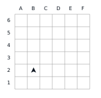

<!-- Guió del formador: Fitxa «Què farà el robot?», exercici 1, «Dos trams». Feu una predicció individual, contrasteu-la en parella i proveu-la. No mostreu encara la diapositiva següent. Font: _content/activitats/tb-prediu-el-resultat.md. -->

---

<!-- _class: solution -->

## Comprovem la predicció

Dossier · p. 5 · exercici 1

Visita **B3 → B4 → C4**.

Acaba en **C4, mirant a l’est**.

El gir canvia on mira el robot; **no el mou de casella**.

<!-- Guió del formador: Compareu camí i orientació, no sols la casella final. A continuació canviarem una tecla per analitzar la primera diferència. -->

---

<!-- _class: worksheet visual -->

## Localitzem una tecla equivocada

Dossier · p. 7 · exercici 1

Volem fer el mateix camí fins a **C4**.

Quina és la primera instrucció que ens en separa?

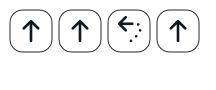

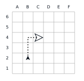

<!-- Guió del formador: Fitxa «Troba i corregeix l’error», exercici 1. Anticipeu el resultat del codi donat abans de modificar-lo. Cada prova es reinicia a B2 mirant al nord. Font: _content/activitats/tb-depura-el-codi.md. -->

---

<!-- _class: solution -->

## Canviem el gir i repetim la prova

Dossier · p. 7 · exercici 1

**Tercera tecla: dreta en lloc d’esquerra**.

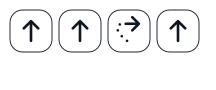

Abans: **A4, mirant a l’oest**.
Després: **C4, mirant a l’est**.

«Hem canviat ___ perquè havíem observat ___.»

<!-- Guió del formador: Relacioneu la correcció amb la primera diferència, en el tercer comandament. No accepteu només «ara funciona»: demaneu una observació de la prova. -->

---

<!-- _class: worksheet visual -->

## Repte 2 · Dibuixem tres escalons

Dossier · p. 10 · exercici 2

Quina part del camí es repeteix?

Escriviu les tecles d’**un escaló** i executeu tota la base **tres vegades**.

On acaba cada execució? Cap a on mira?

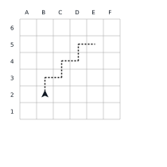

<!-- Guió del formador: Fitxa «Dibuixa per parts», exercici 2. En el model de paper i simulador el retolador està baixat: avançar i retrocedir deixen traç; repassar no esborra. Els separadors de planificació no són funcions del robot. Font: _content/activitats/tb-dibuixa-per-parts.md. -->

---

<!-- _class: solution -->

## Una base, tres execucions

Dossier · p. 10 · exercici 2

**Avança → Dreta → Avança → Esquerra**

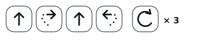

B2 ↑ → C3 ↑ → D4 ↑ → **E5 ↑**

Cada escaló deixa el robot orientat per començar el següent.

<!-- Guió del formador: Tres vegades vol dir tres execucions totals. Demaneu què passaria si faltara l’últim gir. Comproveu l’orientació entre execucions. -->

---

<!-- _class: worksheet visual -->

## Una tasca, tres capses

Dossier · p. 12 · exercici 2

**Empenta → Torna → Canvia de columna → Recupera l’orientació**

La mateixa base ha de servir per a la capsa següent.

Quin moviment prepara la nova execució?

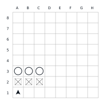

<!-- Guió del formador: Comprovació guiada o ampliació segons el ritme. Fitxa «Primer aproxima’t, després empeny», exercici 2. La base és avançar, retrocedir, dreta, avançar, esquerra, tres execucions totals. Capses A2/B2/C2 a A3/B3/C3; robot final D1 nord. Els braços només empenten cap endavant. Font: _content/activitats/tb-aproxima-i-empeny.md. -->

---

<!-- _class: pause -->

## Pausa i canvi de robot

En tornar, canviem els botons per peces de programació.

Mantindrem la mateixa manera de treballar:
**predir, programar i comprovar**.

---

<!-- _class: hardware -->

## Coding Set · Programar amb peces

Dossier · p. 2

<figure></figure>

<b>Tauler:</b> preparem el programa amb peces.

<b>Torre:</b> llig les peces i envia les ordres.

<b>Robot:</b> executa els moviments.

Els nombres permeten abreujar els trams rectes.

<!-- Guió del formador: Assenyaleu els tres elements. Feu veure que la representació canvia però continua sent una seqüència d’instruccions. Font local: _content/tutorials/cs-primeres-passes.md. -->

---

## Coding Set · El programa queda a la vista

Dossier · p. 2

- **Peces sobre el tauler:** podem llegir, discutir i canviar el programa abans d’executar-lo.
- **Nombres:** abreugen els trams de moviment.
- **Bucles delimitats:** repeteixen només una part del programa.
- **Funcions:** permeten definir una seqüència i cridar-la en diferents punts.

**A l’aula:** comparar solucions i reutilitzar un patró de moviment.

<!--
Guió del formador: Destaqueu la separació entre robot i programa: podem modificar les peces sense moure el robot del punt inicial. Compareu els tres casos: Coding Express situa les accions a la via; Tale-Bot desa les ordres introduïdes amb botons; Coding Set manté el programa visible al tauler. Música, dansa i moviment aleatori són comportaments predefinits si el kit inclou les peces; compondre melodies pròpies requereix el Musician Add-on. Les funcions i els bucles són capacitats del kit base, sense complements. No poseu nombres sota definir o cridar.
Fonts: https://matatalab.com/en/node/62 i https://matatalab.com/en/node/63 ; tutorial local cs-funcions-blocs-divertits.md. La comparació didàctica és una síntesi pròpia a partir de les formes de programació dels tres robots.
-->

---

<!-- _class: section -->

## Activitats amb Coding Set

Dossier · p. 2

Nombres · Bucles · Funcions

**Què s’executa una vegada? Què es repeteix?**

---

<!-- _class: worksheet visual -->

## Repte 3 · Abreuja els trams rectes

Dossier · p. 14 · exercici 1

Inici: **B2, mirant al nord**.

Representeu el camí amb peces de moviment i nombres.

Quines peces necessiten un nombre?

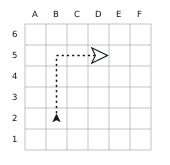

<!-- Guió del formador: Fitxa «Quin codi posaré?», exercici 1. Prepareu la resposta abans d’executar. El nombre va davall del moviment i indica passos. Els girs d’aquests exercicis no porten nombres. Font: _content/activitats/cs-escriu-el-codi.md. -->

---

<!-- _class: solution -->

## Dos trams i un gir

Dossier · p. 14 · exercici 1

**Avança 3 → Dreta → Avança 2**

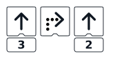

Acaba en **D5, mirant a l’est**.

Els nombres abreugen els avanços; el gir canvia l’orientació.

<!-- Guió del formador: Seguiu primer les tres caselles del primer tram i després les dues del segon. Un nombre no indica centímetres ni velocitat. -->

---

<!-- _class: worksheet visual -->

## Repte 4 · Què queda dins del bucle?

Dossier · p. 18 · exercici 2

Feu **un avanç inicial** i després **dos escalons**.

Delimiteu les peces que es repeteixen.

Què passaria si l’avanç inicial quedara dins del bucle?

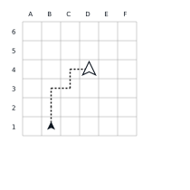

<!-- Guió del formador: Fitxa «Què pose dins del bucle?», exercici 2. El nombre va davall de l’inici del bucle. Feu marcar on comença i acaba la repetició abans de provar. Font: _content/activitats/cs-que-pose-dins-del-bucle.md. -->

---

<!-- _class: solution -->

## L’aproximació queda fora

Dossier · p. 18 · exercici 2

**Un avanç + dues execucions de l’escaló**

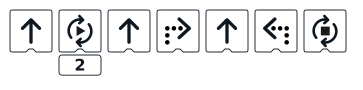

Només es repeteixen les peces entre l’inici i el fi del bucle.

Acaba en **D4, mirant al nord**.

<!-- Guió del formador: Si l’avanç inicial entrara en el bucle, s’executaria dues vegades, una en cada volta. Compareu les trajectòries, no només el nombre de peces. -->

---

<!-- _class: worksheet visual -->

## Repte 5 · Defineix i crida un escaló

Dossier · p. 17 · exercici 2

**Fila inferior:** definiu les ordres d’un escaló.

**Fila principal:** feu dues crides.

Definir la funció la posa en marxa?

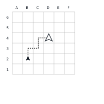

<!-- Guió del formador: Fitxa «Divideix i crea funcions», exercici 2. Cada crida executa la definició i després torna al programa principal. No poseu nombres davall de definir ni de cridar. Font: _content/activitats/cs-divideix-i-crea-funcions.md. -->

---

<!-- _class: solution -->

## Definir i executar són accions diferents

Dossier · p. 17 · exercici 2

<figure><figcaption>Definició</figcaption></figure><figure><figcaption>Programa principal</figcaption></figure>

**Definició:** Avança → Dreta → Avança → Esquerra.

**Dues crides:** B2 ↑ → C3 ↑ → D4 ↑.

La definició s’executa quan el programa la crida.

<!-- Guió del formador: Seguiu amb el dit la principal, baixeu a la definició en cada crida i torneu a la peça següent de la principal. -->

---

<!-- _class: solution -->

## Funcions i bucles, junts

Dossier · p. 20 · exercici 1

**La funció:** quines ordres executem.

**El bucle:** quantes vegades les executem.

<figure><figcaption>Definició de l’escaló</figcaption>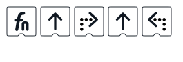</figure><figure><figcaption>Programa principal</figcaption>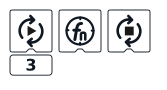</figure>

Predieu on acabarà després de **tres crides** a l’escaló.

<!-- Guió del formador: Comprovació conjunta, fitxa «Combina funcions i repeticions», exercici 1. Mostreu la definició al material abans d’executar. Des de B2 nord, acaba en E5 nord. No hi ha nombres davall de definir ni de cridar; el 3 acompanya l’inici del bucle. Font: _content/activitats/cs-combina-funcions-i-repeticions.md. -->

---

## Llengua · Un conte que es recorre

**Objectiu:** ordenar i narrar una història.

1. Situem tres escenes al tapís.
2. Decidim l’ordre i el justifiquem.
3. Programem el recorregut.
4. Narrem cada escena quan hi arribem.

**Observem:** coherència temporal, expressió oral i justificació.

<!-- Guió del formador: Exemple curricular del PDF original. Amb el mateix recorregut podem avaluar narració: arribar a la meta no demostra, per si sol, que s’ha ordenat i explicat bé la història. -->

---

<!-- _class: worksheet visual -->

## Matemàtiques · Una figura que es repeteix

Dossier · p. 10 · exercici 1

**Dos avanços + gir a la dreta**.

Quatre execucions totals.

Quina figura apareixerà?
On acabarà mirant el robot?

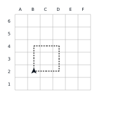

<!-- Guió del formador: Recupereu la demostració matemàtica del PDF: des de B2 nord, quatre execucions tanquen el quadrat i recuperen posició i orientació. Si la graella revela la figura, centreu la predicció en l’orientació i la base mínima. Font: _content/activitats/tb-dibuixa-per-parts.md, exercici 1. -->

---

## Ara, al vostre cicle

Dossier · p. 4

Dissenyeu una activitat amb:

- **Un objectiu curricular** i un grup concret.
- Un robot, un tapís senzill i poques instruccions.
- Una decisió que haja de prendre l’alumnat.
- Una evidència que permeta observar què ha après.

Prepareu la consigna i una possible solució. **Proveu-la.**

<!-- Guió del formador: Agrupeu per Educació Infantil, Primer cicle, Segon cicle o Tercer cicle segons els participants. Les activitats de patrons, funcions i bucles d’aquesta sessió són recursos de formació: adapteu-ne la dificultat al grup. Faciliteu consignes orals i visuals, símbols llegibles i rols rotatius. -->

---

## Compartim una proposta per cicle

Dossier · p. 4

«Volem que aprenguen…»

«Hauran de decidir…»

«Sabrem que ho han entés quan…»

**Quina prova heu fet? Què heu hagut de canviar?**

<!-- Guió del formador: Demaneu evidències de l’objectiu curricular. Per donar suport, marqueu l’inici, reduïu les ordres o permeteu explicar oralment. Per ampliar, canvieu un obstacle o l’orientació inicial. -->

---

<!-- _class: closing -->

## Què provaràs primer?

Dossier · p. 4

**Una activitat concreta. Amb quin grup? Què observaràs?**

Per a la sessió següent: una solució explicada, un error revisat
i una possible aplicació a l’aula.

Abans d’executar: pensem i expliquem.

Després d’executar: comparem i revisem.

<!-- Guió del formador: Recolliu una proposta aplicable. No cal una programació completa: un objectiu, una consigna i una observació són suficients per planificar la primera prova. -->

---

<!-- _class: resources -->

## Recursos per continuar

Dossier · p. 4

- [Quadern complet de la sessió](https://roboticadocents.github.io/output/pdf/sessio-1-handout-compacte.pdf)
- [Simulador de Tale-Bot i Coding Set](https://roboticadocents.github.io/sim/)
- [Fitxes de Tale-Bot](https://roboticadocents.github.io/_assets/activitats/kits/tb-fitxes-paper.pdf) i [solucionari](https://roboticadocents.github.io/_assets/activitats/kits/tb-solucions-paper.pdf)
- [Fitxes de Coding Set](https://roboticadocents.github.io/_assets/activitats/kits/cs-fitxes-paper.pdf) i [solucionari](https://roboticadocents.github.io/_assets/activitats/kits/cs-solucions-paper.pdf)
- [Portal: activitats, tutorials i situacions d’aprenentatge](https://roboticadocents.github.io/)

<!-- Guió del formador: Els enllaços de fitxes apunten al portal per funcionar també des del PDF de distribució. El PDF original del company es conserva a output/pdf/sessio-1-presentacio.pdf. -->
