<!-- _class: cover -->

## Codey Rocky

**Dels botons als sensors**

Itinerari 4 · Sessió 2

Programem el moviment i les reaccions del robot
en paper, al simulador i amb Codey Rocky.

<!--
Guió del formador: Sessió centrada només en Codey Rocky. Manteniu el treball per parelles de la sessió 1, amb canvi de rols. La durada no s’ha fixat: seleccioneu reptes segons el nivell i el temps real. El recorregut principal segueix cinc etapes i arriba a una resposta de Rocky basada en una lectura, abans de l’aplicació a l’aula. Després del tancament i els recursos hi ha un apèndix opcional de negació, i/o i línia. Ajusteu la pausa a un canvi d’etapa segons l’horari real. No s’introdueix Python. Les respostes apareixen després de les consignes; avanceu a la comprovació després de recollir prediccions.
Preparació: PDF de l’alumnat de 18 pàgines, llapis, navegador i, si en disposeu, Codey Rocky carregat, cable USB de dades i mBlock. Per als sensors: cartolines clares/fosques/roges i cinta negra ampla. Els JSON són del simulador; les peces es reconstrueixen a mBlock per al robot físic. No afirmeu que s’ha validat un muntatge físic si no l’heu provat.
Fonts: sessió 1 del repositori, sim/codey-activities.json, tutorials cr-primeres-passes.md i cr-sensors-llum-so-linia.md; documentació de Makeblock indicada en les notes dels blocs.
-->

---

## Recuperem una prova de la sessió 1

Compartiu en parella:

- Una **solució que podeu explicar**.
- Un error que heu revisat i la prova que l’ha resolt.
- Una possible aplicació amb el vostre grup.

**Quina pregunta va ajudar a entendre el programa?**

<!-- Guió del formador: Aquest és el retorn del treball autònom que es va proposar al tancament de la sessió 1. Si algú no ha pogut practicar, pot partir d’un exemple resolt al taller. Recolliu dues o tres aportacions; no convertiu el retorn en una correcció de totes les fitxes. Font: it4-sessio-1.md, diapositiva de tancament. -->

---

## Què ens emportarem?

- Un moviment controlat amb **potència, temps i aturada**.
- Una resposta programada a un **botó o una lectura**.
- Una condició comprovada amb casos diferents.
- Una correcció explicada amb les dades de la prova.
- Una proposta per treballar un aprenentatge del nostre cicle.

**Predir → Programar → Comprovar → Explicar → Revisar**

<!-- Guió del formador: El fil principal va de la primera càrrega a una resposta basada en sensors i a una proposta d’aula. L’ús de no, i/o i línia és una ampliació final. Recupereu la rutina de la sessió anterior. Ara la predicció ha d’incloure l’entrada: amb quina lectura o quin esdeveniment esperem una resposta? L’èxit no és només que el robot faça alguna cosa, sinó poder explicar per què ho fa. -->

---

<!-- _class: compact-table -->

## El recorregut de la sessió

| Etapa | Què comprovarem abans de continuar? |
| :--- | :--- |
| 1. Preparar i carregar | Codey respon als botons sense USB |
| 2. Activar respostes | Expliquem què inicia i què repeteix el programa |
| 3. Controlar el moviment | Sabem avançar, girar i aturar els motors |
| 4. Respondre als sensors | Una lectura determina una resposta |
| 5. Aplicar-ho a l’aula | Proposem una activitat i dos casos de prova |

**Al final:** ampliacions opcionals d’operadors i seguiment de línia.

<!-- Guió del formador: Aquest és el fil conductor; el ritme i la tria de proves depenen del grup. La posada en marxa és una demostració guiada que després es posa en pràctica. Cada repte segueix predicció, prova, explicació i canvi. Les ampliacions són després del tancament i els recursos: no cal recórrer-les per completar el fil principal. No impliqueu que cal acabar totes les fitxes abans de passar d’etapa. -->

---

## Una activitat, tres entorns

| En paper | Al simulador | Amb el robot |
| :--- | :--- | :--- |
| Prediem amb les dades donades | Carreguem les peces i l’escenari | Reconstruïm les peces a mBlock |
| Deixem una traça o una proposta | Canviem una entrada i comprovem | Mesurem i ajustem els valors |

**Compartim la consigna i el criteri de comprovació.**

Canviem els rols: una persona prediu; l’altra prova i registra.

<!-- Guió del formador: No cal fer cada exercici tres vegades. Trieu l’entorn que resolga la necessitat del grup i feu una transferència breu a un altre quan aporte informació. Les fitxes tenen espai per a predicció, resultat, dificultat i canvi, i dubte pendent. Font: _content/activitats/README.md i sim/codey-activities.json. -->

---

<!-- footer: "Robòtica per a docents · Sessió 2 · 1/5 · Preparar i carregar" -->
<!-- _class: section -->

## 1 · Preparar i carregar

**Comprovem que el programa queda al robot.**

Carreguem dues respostes i les provem sense USB.

---
<!-- _class: hardware -->

## Codey i Rocky

<figure></figure>

<b>Codey:</b> pantalla LED, RGB, botons i sensors de llum i so.

<b>Rocky:</b> erugues i sensor infraroig/de color orientable.

<b>mBlock:</b> preparem les peces i les connectem a un esdeveniment.

<!--
Guió del formador: Localitzeu físicament les dues parts. Comenceu amb Codey quiet: els primers reptes no necessiten desplaçament. Després incorporarem el sensor de Rocky. Diferencieu la matriu de pantalla de l’indicador RGB.
Fonts: _content/robots/robot-codey-rocky.md; Makeblock, https://support.makeblock.com/hc/en-us/articles/1500004392242-About-Codey-Rocky . Imatge del catàleg del projecte: _assets/robots/codey-rocky.webp.
-->

---

<!-- _class: compact-table -->

## Dels passos al control dels motors

| Als reptes de Tale-Bot i Coding Set | Amb Codey Rocky |
| :--- | :--- |
| Planifiquem passos i girs predefinits | Fixem potència, durada i aturada |
| Raonem sobre un recorregut en caselles | Mesurem distàncies i angles obtinguts |
| Preparem una seqüència d’ordres | Podem consultar sensors mentre es mou |

«Discret» descriu les ordres de pas; el desplaçament físic és continu.

**Ja no podem assumir: una ordre = una casella o un gir de 90°.**

<!-- Guió del formador: La comparació descriu els reptes de la sessió 1, no totes les capacitats possibles dels robots. «Discret» es refereix a les unitats d’ordre (passos i girs), no a salts físics: els tres robots es desplacen de manera contínua. Codey també rep instruccions discretes, però aquestes controlen l’estat dels motors. Codey i Rocky són dues parts del mateix robot. Amb Codey podem separar esdeveniments, lectures i respostes i corregir el moviment durant l’execució. Fonts: sessió 1 i Makeblock, https://makeblock-micropython-api.readthedocs.io/en/latest/codey%26rocky/rocky/motion.html . -->

---

## Posada en marxa · Preparem Codey

- **Codey carregat**, ordinador i cable micro-USB de dades.
- Localitzem l’encesa, el connector USB i els botons A i B.
- Comencem amb Codey quiet; Rocky s’incorpora per al moviment.

**Primera comprovació:** una resposta pròpia als botons, sense USB.

[Guia pas a pas i fonts oficials](https://roboticadocents.github.io/tutorial/cr-primeres-passes/)

<!-- Guió del formador: Mostreu les dues parts del robot i el connector. Si es treballa sense robot, obriu el simulador; la connexió i càrrega només es poden practicar amb maquinari. Font: manual oficial Code for Fun with Codey Rocky, pàgines impreses 1–4 (p. 3–6 del PDF), https://support.makeblock.com/hc/en-us/article_attachments/13133887873047 . Components i alternatives: https://support.makeblock.com/hc/en-us/articles/12990942477847-A-Beginner-s-Guide-to-Codey-Rocky . -->

---

<!-- _class: manual-screen -->

## La interfície de mBlock

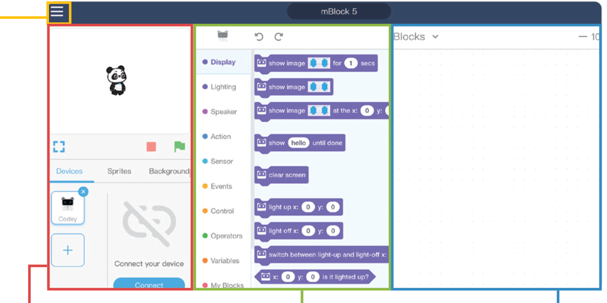

**Esquerra:** dispositiu i connexió. **Centre:** peces. **Dreta:** programa.

Makeblock · Manual oficial, p. 2. Edició anterior de mBlock; l’aspecte pot variar.

<!-- Guió del formador: Localitzeu les tres zones també en l’ordinador del taller. Diferencieu Devices de Sprites: ací programem Codey, no el personatge de l’escenari. Captura real extreta de Code for Fun with Codey Rocky, p. impresa 2 (p. 4 del PDF), retall sense modificar el contingut: https://support.makeblock.com/hc/en-us/article_attachments/13133887873047 . -->

---

<!-- _class: manual-screen -->

## Connexió USB amb mBlock 5

<figure>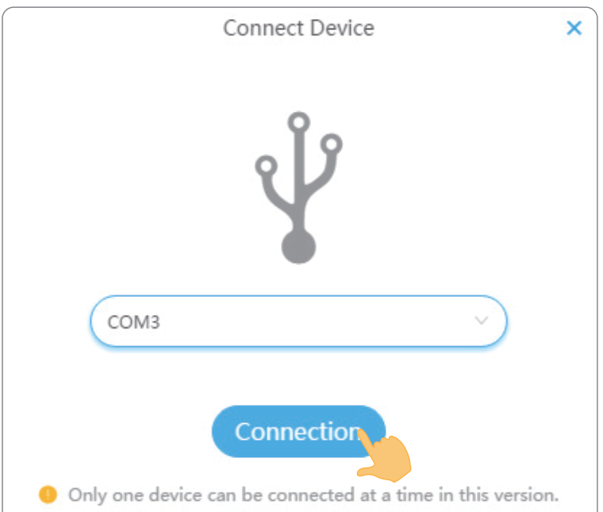<figcaption>Makeblock · Manual oficial, p. 3. Edició anterior de mBlock.</figcaption></figure>
<ol><li>Connecteu Codey per USB i enceneu-lo.</li><li>A <strong>Dispositius</strong>, afegiu <strong>Codey</strong>.</li><li>Premeu <strong>Connecta</strong> i trieu el port del vostre equip.</li><li>Espereu la confirmació.</li></ol>
<strong>COM3 és un exemple:</strong> el nom del port pot ser diferent.

Al web: connexió directa o mLink, segons l’entorn.

<!-- Guió del formador: Demostreu la variant real del taller. Captura real del manual oficial, p. impresa 3 (p. 5 del PDF), retall del diàleg sense alterar-ne el contingut: https://support.makeblock.com/hc/en-us/article_attachments/13133887873047 . L’edició del manual és anterior: no forceu la tria COM3 ni un nom de botó si la versió actual usa una altra etiqueta. Al web, Switch to mLink requereix mLink instal·lat i actiu; la connexió directa pot demanar autorització del dispositiu. Fonts de contrast: https://support.makeblock.com/hc/en-us/articles/1500008637961-Program-Codey-Rocky-with-mBlock-5 ; https://support.makeblock.com/hc/en-us/articles/4402733426327-Update-the-Firmware-of-Codey-Rocky . -->

---

<!-- _class: compact-table -->

## En viu o Càrrega?

| Mode | Execució | Sense connexió amb mBlock |
| :--- | :--- | :--- |
| En viu / Live | Necessita la connexió activa | El programa no pot continuar funcionant |
| Càrrega / Upload | Transferim el programa a Codey | Pot funcionar autònomament |

**Al taller, usem Càrrega per als programes de botons i d’inici.**

Desar el projecte conserva el fitxer; carregar-lo programa el robot.

<!-- Guió del formador: Cada modificació del programa en mode Càrrega s’ha de transferir de nou. Una prova En viu és útil si es volen executar ordres amb connexió permanent; no la confongueu amb un programa autònom. La primera prova de botó de la guia oficial usa Upload. Fonts: manual oficial, inici ràpid p. 4; apartat Start programming de https://support.makeblock.com/hc/en-us/articles/1500008637961-Program-Codey-Rocky-with-mBlock-5 . -->

---

<!-- _class: manual-screen -->

## Primera càrrega · Cara i salutació

<figure>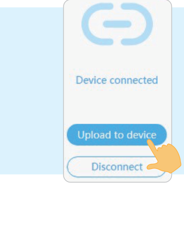<figcaption>Makeblock · Manual oficial, p. 4. Edició anterior de mBlock.</figcaption></figure>

Prepareu dues piles en <strong>Codey</strong>:
<ul><li><strong>Botó A → mostra una cara pròpia.</strong></li><li><strong>Botó B → mostra «Hola».</strong></li></ul>
Seleccioneu <strong>Càrrega</strong>, transferiu el programa i proveu els botons.

Desconnecteu l’USB i torneu a provar.

<strong>Canvieu una resposta i carregueu de nou.</strong>

<!-- Guió del formador: La captura mostra el control real Upload to device del manual; busqueu l’equivalent Upload/Carrega de la versió del taller. El nostre programa de cara i salutació és una adaptació didàctica, no el contingut de la captura. Captura real de Code for Fun with Codey Rocky, p. impresa 4 (p. 6 del PDF), retall sense alterar el contingut: https://support.makeblock.com/hc/en-us/article_attachments/13133887873047 . El manual explica que la càrrega permet executar sense mBlock. Mostreu les peces al mBlock real i espereu la confirmació abans de desconnectar. Contrast: https://support.makeblock.com/hc/en-us/articles/1500008637961-Program-Codey-Rocky-with-mBlock-5 . -->

---

<!-- _class: compact-table -->

## Si la primera prova falla

| Què passa? | Què comprovem? |
| :--- | :--- |
| mBlock no detecta Codey | Encesa, cable de dades, port i dispositiu |
| Només funciona connectat | Mode triat i càrrega completada |
| Mostra una resposta antiga | Si hem carregat l’últim canvi |
| Hi ha un avís de firmware | Procediment oficial per USB |

**Abans de seguir:** A i B responen sense USB. [Guia de consulta](https://roboticadocents.github.io/tutorial/cr-primeres-passes/)

<!-- Guió del formador: Si un equip no resol la connexió, continueu el repte al simulador i registreu el missatge i l’entorn per revisar-lo després. Firmware: actualitzeu si mBlock ho indica; no és necessari repetir l’actualització per cada programa ni s’ha de desconnectar el cable durant el procés. Fonts: https://support.makeblock.com/hc/en-us/articles/1500004266501-FAQs-on-Codey-Rocky ; https://support.makeblock.com/hc/en-us/articles/4402733426327-Update-the-Firmware-of-Codey-Rocky . -->

---

<!-- footer: "Robòtica per a docents · Sessió 2 · 2/5 · Activar respostes" -->
<!-- _class: section -->

## 2 · Activar respostes

**Distingim què inicia una acció i què la fa repetir.**

Provem l’encesa, el botó A i una seqüència de pampallugues.

---
<!-- _class: code-study short -->

## Repte 1 · Inici i botó A

Fitxes Codey · p. 3 · exercici 1

<strong>Què practiquem?</strong> Distingir l’encesa de la pulsació d’un botó com a inici d’una resposta.

Ara comparem **dos esdeveniments**: engegar Codey i prémer **A**.
Què mostra en cada moment?

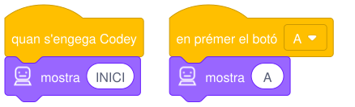

[Carrega l’exercici](https://roboticadocents.github.io/sim/?robot=codey-rocky&activity=cr-botons-i-esdeveniments&exercise=1)

<!-- Guió del formador: Tanquem la demostració de càrrega i obrim un repte diferent: una resposta a l’inici i una altra al botó. El canvi respecte de la prova A/B és l’esdeveniment que inicia cada pila. Recolliu la predicció abans de prémer Executa. Al simulador, Executa activa la pila d’inici; el botó A del panell activa la pila A. Les pestanyes seleccionen què editem, no executen el programa. Font única de l’exercici: sim/codey-activities.json, cr-botons-i-esdeveniments, exercici 1. Els SVG són renderitzats pel mateix editor natiu del simulador. -->

---

<!-- _class: solution readings -->

## Cada esdeveniment activa la seua pila

| Què fem? | Què observem? |
| :--- | :--- |
| Iniciem el programa | La pantalla mostra **INICI** |
| Premem A | La pantalla mostra **A** |
| No premem A | La pila A encara no s’executa |

Canvieu la resposta del botó i torneu a provar.

**Què heu canviat: l’esdeveniment o la resposta?**

<!-- Guió del formador: Per a l’ampliació es pot usar el botó B o C, però no cal completar totes les variants. En Codey, C és programable: no és una aturada automàtica dels motors. Font: fitxa cr-botons-i-esdeveniments i extensió oficial Codey documentada a docs/SIMULADOR-CODEY.md. -->

---

<!-- _class: code-study tall -->

## Pantalla i llum són dues eixides

Fitxes Codey · p. 2 · exercici 2

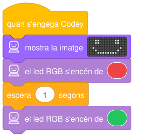

Quina imatge i quin color quedaran al final?

<!-- Guió del formador: Espereu la resposta: cara feliç i RGB verd. Canviar el LED no substitueix la imatge de la matriu. Feu una comprovació curta abans d’avançar; no cal una diapositiva de solució perquè les dues eixides són observables al mateix robot. Font: cr-prediu-el-resultat, exercici 2. -->

---

<!-- _class: code-study tall -->

## Repte 2 · Tres pampallugues

Fitxes Codey · p. 9 · exercici 1

<strong>Què practiquem?</strong> Identificar quines ordres formen una repetició completa.

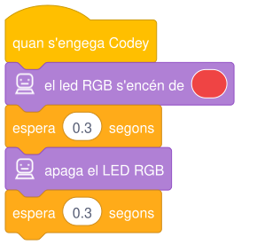

Feu-la tres vegades amb <strong>un sol repeteix</strong>. Quines peces hi van dins?

<!-- Guió del formador: La consigna té una unitat completa: encendre, esperar, apagar i esperar. Demaneu que la delimiten abans d’inserir el bucle. Canvieu rols. Font: cr-delimita-el-bucle, exercici 1. -->

---

<!-- _class: code-study solution tall -->

## Repetim la unitat completa

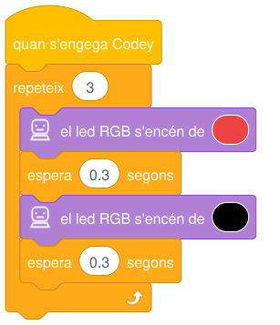

<strong>Tres execucions; LED apagat al final.</strong> Ara aplicarem ordres als motors.

<!-- Guió del formador: Acaba amb el LED apagat. Si el ritme es veu poc, augmenteu les dues esperes i conserveu la mateixa unitat. Relacioneu-ho amb la repetició de Coding Set: ací el bloc delimita el cos que es repeteix. Font: cr-delimita-el-bucle, solució de l’exercici 1. -->

---

<!-- footer: "Robòtica per a docents · Sessió 2 · 3/5 · Controlar el moviment" -->
<!-- _class: section -->

## 3 · Controlar el moviment

**Passem dels passos predefinits a decidir potència, durada i aturada.**

Comparem dos avanços i dos girs, i comprovem quan paren els motors.

---
<!-- _class: compact-table -->

## Tres ordres, tres efectes

| Ordre de moviment | Quan passa a la peça següent? | Què fan els motors? |
| :--- | :--- | :--- |
| Avança al 20% durant 1 s | En acabar el segon | S’aturen en acabar |
| Avança al 20%, sense durada | De seguida | Continuen actius |
| Atura el moviment | De seguida | S’aturen |

**«Espera» pausa la seqüència; no atura els motors.**

Abans de moure Rocky, programeu i proveu **C → atura**.

<!-- Guió del formador: Mostreu les peces temporitzada i contínua al menú Acció. Potència és una ordre al motor: no són cm/s ni percentatge de recorregut. En la peça temporitzada, la mateixa pila espera i els motors s’aturen al final; altres piles poden executar-se. En la contínua, l’ordre següent s’executa amb els motors actius; una nova ordre de motor pot substituir l’anterior. C només atura si hem programat eixa resposta. Fonts primàries: https://qiniu.makeblock.com/education-makeblock-com/CodeyRockyNeuronTeachersBook.pdf ; https://makeblock-micropython-api.readthedocs.io/en/latest/codey%26rocky/rocky/motion.html . -->

---

<!-- _class: code-study short -->

## Repte 3 · Un segon o dos?

Fitxes Codey · p. 17 · exercici 1

<strong>Què practiquem?</strong> Aïllar l’efecte del temps sobre la distància i comprovar l’aturada.

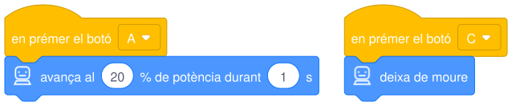

Predigueu la distància i l’aturada. Proveu <strong>1 s</strong> i després <strong>2 s</strong>, amb el mateix inici i potència.

[Carrega la prova](https://roboticadocents.github.io/sim/?robot=codey-rocky&activity=cr-moviment-discret-continu&exercise=1)

<!-- Guió del formador: Primer en paper: dues prediccions, distància i estat final dels motors. Després mesureu al simulador o al robot; torneu al mateix punt i orientació entre proves. Les dues versions s’aturen soles. Sense obstacles i amb la mateixa potència, més temps dona més recorregut; no prometeu el doble exacte al robot. Feu tres intents i, si escau, canvieu només la potència. Font: cr-moviment-discret-continu, exercici 1. -->

---

<!-- _class: code-study short -->

## Repte 4 · «FI» vol dir aturat?

Fitxes Codey · p. 18 · exercici 2

<strong>Què practiquem?</strong> Distingir una espera del programa d’una aturada dels motors.

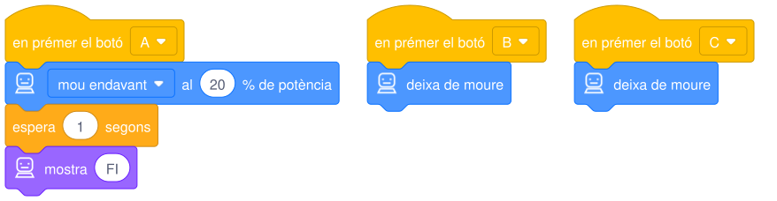

Què fa durant <strong>espera</strong>? I quan apareix <strong>FI</strong>? Predigueu, proveu i atureu amb B.

[Carrega la prova](https://roboticadocents.github.io/sim/?robot=codey-rocky&activity=cr-moviment-discret-continu&exercise=2)

<!-- Guió del formador: No doneu la resposta abans de recollir la predicció. Useu una zona lliure i potència baixa, amb B i C comprovats com a aturada. Si no hi ha espai, feu aquesta observació al simulador. L’objectiu és distingir final de seqüència, eixida de pantalla i estat dels motors. Font: nova fitxa, exercici 2. -->

---

<!-- _class: code-study solution short -->

## Cal donar l’ordre d’aturar

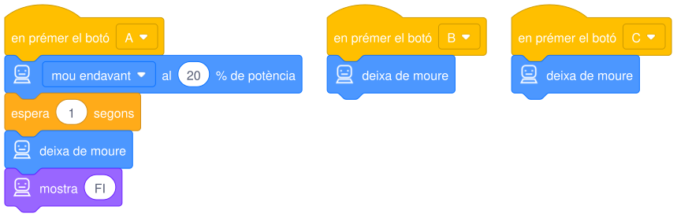

<strong>Avança → espera → atura → mostra FI.</strong> La pantalla i els motors mantenen estats independents.

<!-- Guió del formador: Abans de la correcció, Rocky continuava movent-se durant l’espera i després de FI: acabar la pila no equival a aturar motors. Ara la peça atura canvia explícitament l’estat dels motors. Compareu també amb la peça temporitzada: incorpora durada i aturada. Una altra pila de botó o de sensor podria canviar el moviment. Font: cr-moviment-discret-continu, solució 2; Makeblock, https://support.makeblock.com/hc/en-us/articles/7463536261527-Case-16-Codey-Rocky-moves-forward-and-backward . -->

---

<!-- _class: code-study short -->

## Repte 5 · Quant gira?

Fitxes Codey · p. 18 · exercici 3

<strong>Què practiquem?</strong> Relacionar la durada amb l’angle i ajustar un gir a partir de mesures.

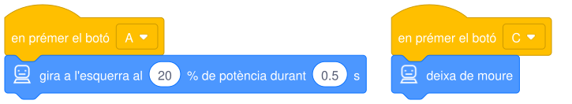

Compareu <strong>0,5 s</strong> i <strong>1 s</strong> des de la mateixa orientació. Quin gir és major? Com obtindríeu un quart de volta?

[Carrega la prova](https://roboticadocents.github.io/sim/?robot=codey-rocky&activity=cr-moviment-discret-continu&exercise=3)

<!-- Guió del formador: El nom esquerra no implica un gir fix de 90°. Primer dibuixeu la predicció; després mesureu l’angle i ajusteu la durada per aproximar un quart de volta. Manteniu potència, superfície i inici. No traslladeu directament el temps del simulador al robot. Font: cr-moviment-discret-continu, exercici 3. -->

---

<!-- _class: compact-table -->

## Calibrar: mesurar i ajustar

| Mantinc | Canvie una sola dada | Registre |
| :--- | :--- | :--- |
| Inici, orientació i superfície | Temps, amb la mateixa potència | Distància o angle obtingut |
| Temps i punt de partida | Potència | Què varia entre intents |

1. Predicció en paper i primera prova.
2. Mesura, canvi justificat i tres intents.
3. Repetició en l’altre entorn i nou ajust.

**Ja controlem el moviment. Ara una lectura decidirà la resposta.**

<!-- Guió del formador: Tanqueu les tres proves demanant una explicació: com s’atura una peça temporitzada? Què passa durant espera amb una peça contínua? Per què esquerra no fixa 90°? Al simulador observeu posició i orientació; al robot useu regla o marques i una referència angular. Fricció, superfície i bateria poden canviar els resultats físics. La potència no és una mesura de velocitat. Ara connectarem aquest control de motors amb les lectures dels sensors. -->

---

<!-- footer: "Robòtica per a docents · Sessió 2 · 4/5 · Respondre als sensors" -->
<!-- _class: section -->

## 4 · Respondre als sensors

**Fem servir una lectura per decidir què fa el robot.**

Comencem amb llum i pantalla. Acabem amb el sensor de Rocky i els motors.

---
<!-- _class: readings -->

## Una lectura es pot comparar

| Entrada | Què ens dona? |
| :--- | :--- |
| Llum de Codey | Un valor de llum ambiental |
| So de Codey | Un valor d’intensitat sonora |
| Botó | Un esdeveniment en prémer-lo |

Primer anotem **la lectura**. Després decidim **la resposta**.

**Al robot:** comparem dues condicions abans de triar un llindar.

<!-- Guió del formador: Useu llum tapada/destapada o veu moderada, sense convertir la prova en un concurs de crits. Al simulador les entrades de llum i so es fixen amb els controls. En el robot les mesures depenen de les condicions reals. Fonts: cr-sensors-llum-so-linia.md i cr-llum-aula.md. -->

---

<!-- _class: code-study -->

## Repte 6 · La comparació al revés

Fitxes Codey · p. 7 · exercici 1

<strong>Què practiquem?</strong> Relacionar una lectura amb la branca que executa el programa.

**Consigna:** mostrar FOSC quan la llum siga menor que 40. Lectura: **20**.

[Prediu i repara una peça](https://roboticadocents.github.io/sim/?robot=codey-rocky&activity=cr-depura-el-codi&exercise=1)

<!-- Guió del formador: El codi donat és intencionadament incorrecte. Amb 20, la comparació 20 > 40 és falsa i mostra CLAR. Cal canviar > per < per complir l’objectiu. Demaneu la primera diferència entre consigna i codi. Font: cr-depura-el-codi, exercici 1. -->

---

<!-- _class: code-study solution -->

## La correcció canvia la branca

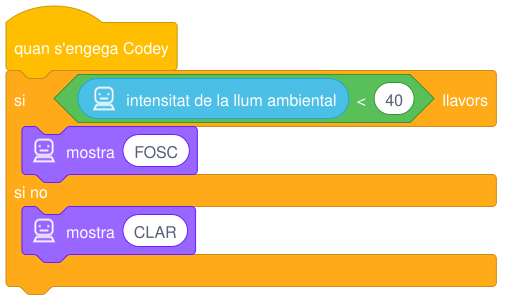

Proveu <strong>20</strong> i <strong>70</strong>. Expliqueu per què el resultat canvia.

<!-- Guió del formador: Amb 20 mostra FOSC; amb 70 mostra CLAR. Eviteu donar per bo el programa amb una sola prova. En passar al robot físic, recolliu lectures reals abans d’interpretar el llindar 40. Font: solució de cr-depura-el-codi, exercici 1. -->

---

## Una decisió o una resposta contínua

Executeu una pila amb **si**. Després canvieu la llum.

**Canvia la resposta sense tornar a executar?**

Ara poseu la comprovació dins d’un **per sempre**.

**Llegir → comparar → respondre → tornar a llegir.**

Ara aplicarem aquesta idea al sensor de Rocky.

<!--
Guió del formador: Una pila d’inici amb un si fa una comprovació en passar per la peça. Per consultar noves lectures cal repetir-la. Feu la demostració amb l’exemple «Si baixa la llum…» del selector del simulador: conté per sempre, una condició, dues eixides i una espera curta. Al robot, la pila carregada ha d’incloure també la consulta repetida. Aquesta és una ampliació guiada, no un exercici nou obligatori de la fitxa.
Fonts: sim/codey.js, exemple light, i semàntica de Control documentada a docs/SIMULADOR-CODEY.md.
-->

---

<!-- _class: readings -->

## Orientem el sensor de Rocky

| Prova | Orientació | Lectura que usem |
| :--- | :--- | :--- |
| Apropar-nos a un objecte | Cap endavant | IR reflectit, escala 0–100 |
| Comparar una línia i el fons | Cap al terra | Grisos, escala 0–100 |
| Reconéixer una superfície roja | Cap al terra | Color detectat: cert o fals |

**Abans de programar, observeu què està llegint el sensor.**

<!--
Guió del formador: L’IR reflectit és una intensitat, no una distància en centímetres. Canvia amb la superfície, l’angle i la separació. Al simulador l’orientació es tria a «Edita l’escenari i calibra el sensor». Per al robot, comproveu que el sensor apunta a la superfície rellevant. Manteniu accessible l’interruptor en les proves de moviment; C només atura si s’hi ha programat l’ordre.
Fonts: cr-sensors-llum-so-linia.md i cr-obstacles-color-seguiment-linia.md; Makeblock, https://support.makeblock.com/hc/en-us/articles/7484512467223-Case-19-Codey-Rocky-identifies-colors i https://support.makeblock.com/hc/en-us/articles/7463724329879-Case-18-Codey-Rocky-avoids-obstacles .
-->

---

<!-- _class: code-study -->

## Repte 7 · El color equivocat

Fitxes Codey · p. 8 · exercici 2

<strong>Què practiquem?</strong> Comprovar si el color detectat compleix la condició amb dues superfícies.

El sensor està sobre una superfície **roja**. Volem mostrar **ROIG**.

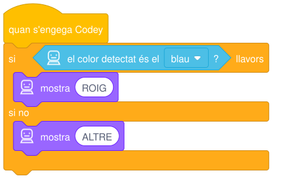

[Prediu el resultat i repara el desplegable](https://roboticadocents.github.io/sim/?robot=codey-rocky&activity=cr-depura-el-codi&exercise=2)

<!-- Guió del formador: Orienteu primer el sensor cap al terra. Amb la superfície roja, la pregunta «és blau?» és falsa i es mostra ALTRE. Demaneu que canvien només l’opció del desplegable i que comproven una superfície roja i una altra. Font: cr-depura-el-codi, exercici 2; Makeblock, Case 19 - Codey Rocky identifies colors, https://support.makeblock.com/hc/en-us/articles/7484512467223-Case-19-Codey-Rocky-identifies-colors . -->

---

<!-- _class: code-study solution -->

## Comprovem dues superfícies

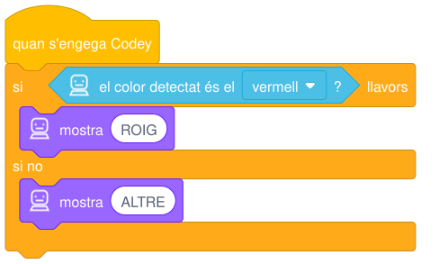

Sobre roig, mostra <strong>ROIG</strong>. Sobre una altra categoria, mostra <strong>ALTRE</strong>.

<!-- Guió del formador: La lectura de color és una entrada per decidir, no la identificació d’un objecte o d’una espècie. En el robot, feu proves amb targetes mates i posicions semblants. Font: solució de cr-depura-el-codi, exercici 2, i cr-ruta-colors.md, Arxiu de colors de l’horta. -->

---

<!-- _class: code-study -->

## Repte 8 · «Fins que» comprova abans

Fitxes Codey · p. 8 · exercici 3

<strong>Què practiquem?</strong> Fer servir una lectura repetida per decidir quan acaba l’avanç.

Volem avançar fins que l’IR supere **60**. La lectura inicial és baixa.

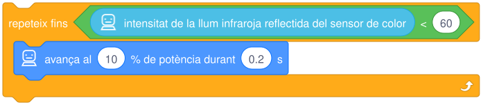

[Què farà el codi donat? Quina peça corregiríeu?](https://roboticadocents.github.io/sim/?robot=codey-rocky&activity=cr-depura-el-codi&exercise=3)

<!-- Guió del formador: Amb una lectura baixa, IR < 60 ja és cert; el bucle donat pot executar zero avanços i passar directament a FI. No confongueu repeteix fins que amb mentre. Atureu la prova física si el muntatge o l’objecte no permeten una lectura repetible. Font: cr-depura-el-codi, exercici 3. -->

---

<!-- _class: code-study solution -->

## Repetim fins que la condició siga certa

Amb IR baix, avancem; quan <strong>IR > 60</strong>, eixim del bucle i aturem.
 <strong>Ja connectem lectura, decisió i motors. Per a què ho usaríem a l’aula?</strong>

<!-- Guió del formador: El diagrama mostra el fragment del bucle; la fitxa i el simulador conserven també atura i mostra FI. El cos usa moviments temporals curts per poder tornar a llegir el sensor entre avanços. El llindar 60 és una dada de l’exercici, no un valor universal del robot. Al simulador pot caldre deixar temps perquè s’aprope a l’objecte. En el robot mesureu i ajusteu el llindar; comenceu amb una prova curta a baixa potència. Font: solució de cr-depura-el-codi, exercici 3. -->

---

<!-- footer: "Robòtica per a docents · Sessió 2 · 5/5 · Aplicar-ho a l’aula" -->
<!-- _class: section -->

## 5 · Aplicar-ho a l’aula

**Convertim un repte del taller en una activitat amb un objectiu d’aula.**

Triem què volem que aprenga el grup i com ho comprovarem amb dos casos.

---
<!-- _class: compact-table -->

## Una pregunta curricular per al robot

| Situació d’aprenentatge | Què volem que expliquen? |
| :--- | :--- |
| [Caretes de la plaça](https://roboticadocents.github.io/situacio/cr-emocions/) | Quina imatge ajuda a contar una escena fictícia? |
| [El mapa de llum de l’aula](https://roboticadocents.github.io/situacio/cr-llum-aula/) | Què canvia entre dues lectures i com les hem preses? |
| [Arxiu de colors de l’horta](https://roboticadocents.github.io/situacio/cr-ruta-colors/) | Quines mostres distingim en les condicions de prova? |

**La resposta del robot ha d’ajudar a observar l’aprenentatge.**

<!-- Guió del formador: Trieu una SdA pròxima a l’interés del grup i obriu-la si hi ha temps. Les cares representen personatges; no es dedueixen emocions reals. Els índexs de llum del robot permeten comparar les proves; no els presenteu com un certificat de confort visual. Confirmeu l’objectiu curricular abans de parlar d’efectes o programació. Fonts: _content/situacions/cr-emocions.md, cr-llum-aula.md i cr-ruta-colors.md. -->

---

## Dissenyeu una activitat per al vostre grup

Concreteu:

- **Què volem que aprenguen** i amb quin cicle.
- Una entrada i una resposta que puguem observar.
- Dos casos de prova que obliguen a prendre decisions.
- Una evidència: predicció, traça, lectura o explicació.

Partiu d’un repte que heu provat hui. Adapteu-lo a **paper, simulador i robot**.

<!-- Guió del formador: Useu els nivells oficials: Educació Infantil, Primer cicle, Segon cicle o Tercer cicle. L’eina i l’autonomia s’adapten al grup; el docent pot programar mentre l’alumnat prediu o interpreta. Per donar suport, oferiu una pila curta i lectures preparades. Per ampliar, demaneu una condició composta o una comprovació repetida. No cal fer les tres execucions; cal que l’objectiu i el criteri siguen coherents en els tres entorns. -->

---

## Compartim una prova

«Amb aquesta entrada, esperàvem…»

«Hem observat…»

«Hem canviat aquesta peça perquè…»

**Quina evidència mostra que l’alumnat ha entés la decisió?**

<!-- Guió del formador: Demaneu una prova realitzada, no només una descripció del projecte. Valoreu també una proposta que encara falla si l’equip ha localitzat i justificat una revisió. Eviteu comparar només l’espectacularitat dels resultats. -->

---

<!-- _class: closing -->

## Per continuar practicant

Trieu una prova per consolidar o una de les ampliacions finals.

Registreu **què esperàveu, què ha passat i què heu canviat**.

Conserveu una solució explicada, un error revisat
i una possible aplicació a l’aula.

**El recorregut principal acaba ací. Les ampliacions són opcionals.**

<!-- Guió del formador: El banc d’activitats no és una llista d’exercicis obligatoris. Cada parella tria segons el nivell i les necessitats. Es pot continuar amb paper, simulador o robot; la comparació entre entorns ha d’aportar una observació concreta. -->

---

<!-- _class: resources -->

## Recursos de la sessió

[Posada en marxa i manual oficial](https://roboticadocents.github.io/tutorial/cr-primeres-passes/)

- [Activitats i tutorials de Codey Rocky](https://roboticadocents.github.io/robot/codey-rocky/#activitats)
- [Fitxes: nou activitats en tres entorns](https://roboticadocents.github.io/_assets/activitats/kits/cr-fitxes-tres-entorns.pdf)
- [Simulador de Codey Rocky](https://roboticadocents.github.io/sim/?robot=codey-rocky)
- [Presentacions i materials presencials](https://roboticadocents.github.io/presencial/)

**Primer prediem; després comprovem i expliquem.**

<!-- Guió del formador: Solucionari separat per a preparar la sessió: https://roboticadocents.github.io/_assets/activitats/kits/cr-solucions-tres-entorns.pdf . Les pàgines de les diapositives fan referència al recull de l’alumnat de 18 pàgines, no al solucionari ni al quadern de la sessió 1. La presentació editable és it4-sessio-2.md; l’HTML i el PDF s’exporten amb export-session-marp.js. -->

---

<!-- _class: section -->
<!-- footer: "Robòtica per a docents · Sessió 2 · Ampliacions opcionals" -->

## Per aprofundir

El recorregut principal ja està complet.

- **A1 · Negació i límits:** què passa exactament en 40?
- **A2 · Condicions combinades:** quan usem «i» o «o»?
- **A3 · Seguiment de línia:** llegir, comparar i corregir motors.

Trieu l’ampliació que ajude a resoldre un dubte o a desenvolupar la vostra proposta.

<!-- Guió del formador: No és una sisena etapa obligatòria. Obriu només l’ampliació adequada després de la posada en comú, o deixeu-la per al treball autònom. Per a la línia recupereu el moviment continu, l’aturada, el llindar i el per sempre. La pausa es pot fer en qualsevol canvi d’etapa segons l’horari real. -->

---

<!-- _class: code-study -->

## A1 · Què passa exactament en 40?

Fitxes Codey · p. 12 · exercici 3

<strong>Què practiquem?</strong> Interpretar una negació i comprovar el valor exacte del llindar.

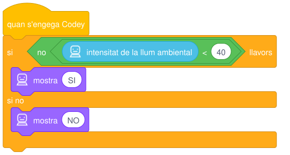

Prediu el text amb llum <strong>39</strong>, <strong>40</strong> i <strong>41</strong>.

<!-- Guió del formador: Primer llegiu el contingut de la peça no; després negueu el resultat. El cas exacte 40 es pot provar en paper o al simulador; no exigiu obtindre aquest valor físic al robot. Font: cr-condicions-i-operadors, exercici 3, amb dos casos de contrast afegits per al taller. -->

---

<!-- _class: solution readings -->

## El límit de la comparació

| Llum | Llum < 40 | No (llum < 40) | Text |
| :--- | :--- | :--- | :--- |
| 39 | Certa | Falsa | **NO** |
| 40 | Falsa | Certa | **SI** |
| 41 | Falsa | Certa | **SI** |

**Menor que** és una comparació estricta.

<!-- Guió del formador: Demaneu una explicació del cas 40 sense mirar la taula. La mateixa cura amb el límit serà necessària en l’IR i els grisos. Font: condició i respostes comprovables amb CodeySimulation.evaluate. -->

---

<!-- _class: readings -->

## A2 · «I» o «o»?

Fitxes Codey · p. 11–12 · exercicis 1 i 2

<strong>Què practiquem?</strong> Distingir quan cal que es complisquen les dues condicions i quan en basta una.

Mateixes lectures: **llum 20** i **so 20**.

1. **Llum < 40 i so > 60**
2. **Llum < 40 o so > 60**

Si la condició és certa, mostrem **SI**. Si és falsa, **NO**.

**Què mostrarà cada programa? Justifiqueu les dues comparacions.**

<!-- Guió del formador: Les dues activitats usen les mateixes lectures per aïllar l’efecte de canviar l’operador. Es poden obrir els exercicis 1 i 2 de cr-condicions-i-operadors al simulador. No mostreu encara la taula següent. Font: sim/codey-activities.json, cr-condicions-i-operadors, exercicis 1 i 2. -->

---

<!-- _class: solution readings -->

## Una de certa no sempre és suficient

| Programa | Què sabem? | Resultat |
| :--- | :--- | :--- |
| Llum < 40 **i** so > 60 | Certa i falsa | **NO** |
| Llum < 40 **o** so > 60 | Certa o falsa | **SI** |

Amb **i**, calen les dues condicions.
Amb **o**, basta que se’n complisca una.

<!-- Guió del formador: Després de justificar aquests casos, demaneu un canvi que faça falsa la segona condició composta: per exemple llum 70 i so 20. Per fer certa la primera: llum 20 i so 70. No convertiu la sessió en una taula de veritat memoritzada; conserveu la relació entre lectura, comparació i resposta. -->

---

<!-- _class: readings -->

## A3 · Calibrem la línia

Fitxes Codey · p. 16 · exercici 3

<strong>Què practiquem?</strong> Triar un llindar a partir de mesures per corregir el moviment.

Dades del paper: **fons 95** i **línia 5**.

1. Trieu el punt mitjà com a primer llindar.
2. Predigueu la branca per a lectures **35** i **65**.
3. Expliqueu què passaria exactament en el llindar.

**Al robot, feu el mateix amb les vostres mesures.**

<!-- Guió del formador: Useu la fitxa Per què perd la línia?, exercici 3. La fórmula del punt mitjà és un punt de partida de calibratge, no una garantia de seguiment. El codi donat té llindar 20 i s’ha de canviar. La superfície i la llum física poden canviar les lectures. Font: cr-segueix-la-vora, exercici 3. -->

---

<!-- _class: solution readings -->

## Un llindar per a dues respostes

**(95 + 5) / 2 = 50**

| Lectura | Grisos < 50 | Eruga esquerra | Eruga dreta |
| :--- | :--- | :--- | :--- |
| 35 | Certa | 10 | 6 |
| 65 | Falsa | 6 | 10 |
| 50 | Falsa | 6 | 10 |

Les potències són **dades d’aquesta prova**; el muntatge determina la resposta física.

<!-- Guió del formador: Amb 50 la comparació estricta és falsa. Aquestes dues respostes estan associades al punt inicial i al sentit de recorregut del model. No presenteu la regla «més fosca = sempre girar cap a…» com una llei independent del muntatge. Font: solució de cr-segueix-la-vora, exercici 3; CodeySimulation.Engine i proves del seguidor. -->

---

## Una correcció que es repeteix

Al simulador, carregueu l’exemple **«Segueix la vora de la línia»**.

- Observeu la lectura i la potència de cada eruga.
- Canvieu **un sol valor**: llindar o potència.
- Torneu a la mateixa posició inicial i compareu.

**Quina dada ajuda a explicar que conserve o perda la línia?**

<!-- Guió del formador: Aquesta demostració és una ampliació: el seguiment resulta de rellegir el sensor i corregir els motors, no d’una ruta reproduïda automàticament. No hi ha dos sensors de línia independents: el simulador usa una única petjada. En el robot, primer situeu el sensor a la vora, proveu el sentit de correcció i calibreu. Podeu mantenir la pràctica en paper amb lectures donades si no hi ha temps o muntatge. Fonts: exemple line de sim/codey.js, docs/SIMULADOR-CODEY.md i cr-sensors-llum-so-linia.md. -->
