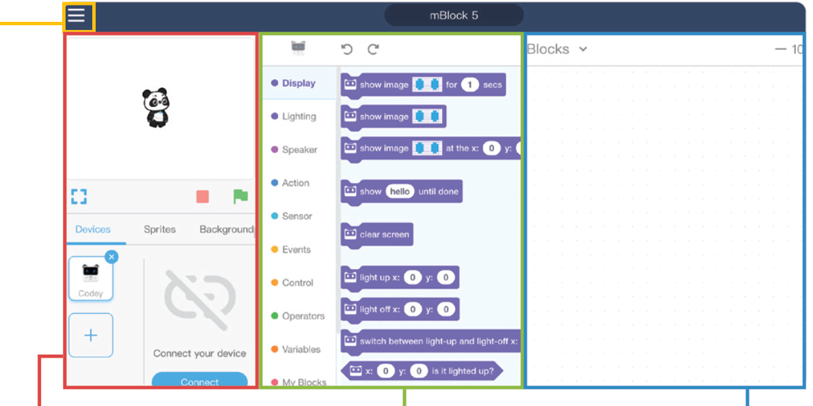
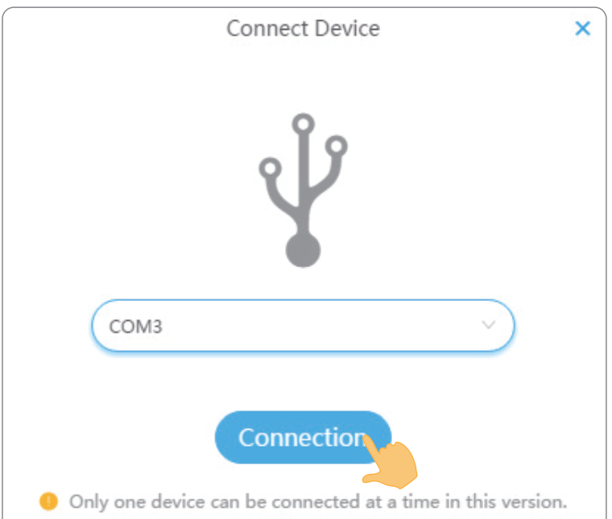
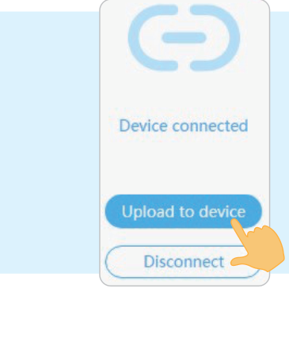

## 🎯 Què aprendrem?

Prepararem Codey i carregarem dues respostes: **A mostra una cara pròpia i B mostra «Hola»**. La comprovació final serà prémer els botons després de desconnectar el cable USB.

- Connectar Codey a mBlock i verificar la comunicació.
- Distingir En viu i Càrrega amb una prova al robot.
- Carregar i revisar una resposta pròpia als botons A i B.

La seqüència adapta el manual oficial **Code for Fun with Codey Rocky** i les instruccions de connexió de Makeblock. Al taller utilitzarem **ordinador, cable USB i mode Càrrega**. La tauleta i el Bluetooth tenen un procediment diferent, enllaçat al final.

## 🧰 Materials i preparació

- Codey amb la bateria carregada; Rocky serà necessari quan treballem el moviment.
- Ordinador amb [mBlock 5 d’escriptori](https://mblock.cc/pages/downloads). Alternativament, [mBlock web](https://ide.mblock.cc/), amb connexió sèrie directa si l’entorn la permet o amb mLink.
- Cable micro-USB **de dades**: un cable que només carrega no permet transferir el programa.
- Una superfície estable per a la primera prova, sense moviment.

Abans del taller, comproveu la connexió en els ordinadors que s’utilitzaran. Anoteu la versió de mBlock i si treballeu amb l’aplicació d’escriptori o amb el navegador, per poder repetir el procediment.

## 🧩 Funcions i controls

- **Codey** és el controlador: conté la matriu LED 16 × 8, els botons A, B i C, l’altaveu i diversos sensors. Pot funcionar separat de Rocky.
- **Rocky** és el xassís amb motors i erugues i sensor infraroig/de color; necessita Codey per executar les ordres.

| Mode de mBlock | Com funciona | Què passa en desconnectar? |
| :--- | :--- | :--- |
| En viu / Live | Les ordres s’executen amb la connexió activa | El programa necessita mantindre la connexió |
| Càrrega / Upload | Transferim el programa a Codey | El programa carregat pot funcionar autònomament |

**Desar el projecte i carregar-lo són accions diferents.** Desar conserva el fitxer per editar-lo; carregar transfereix el programa al robot. Cada canvi que vulguem provar al robot en mode Càrrega requereix una nova càrrega.

## 👣 Pas a pas

### 1. Identifiqueu i prepareu les dues parts

Localitzeu l’encesa, el connector micro-USB i els botons A i B de Codey. Per a la prova de pantalla podeu deixar Codey separat de Rocky. Quan treballeu els motors, col·loqueu-lo en la seua posició sobre el xassís i comproveu que queda ben assentat.

No confongueu una cara preprogramada amb una comprovació de connexió: el robot podria estar executant un programa anterior. La nostra prova ha de mostrar una resposta que acabem de programar.

*Makeblock · Manual oficial, p. 2 (p. 4 del PDF). Captura d’una edició anterior de mBlock; l’aspecte pot variar.*

### 2. Connecteu Codey a l’ordinador

1. Connecteu el cable micro-USB a Codey i a l’ordinador; enceneu Codey.
2. Obriu mBlock 5. A **Dispositius / Devices**, afegiu **Codey**.
3. Premeu **Connecta / Connect** i seleccioneu el port corresponent, si es demana.
4. Comproveu que mBlock confirma la connexió abans de continuar.

*Makeblock · Manual oficial, p. 3 (p. 5 del PDF), edició anterior de mBlock. COM3 és només l’exemple del manual: trieu el port del vostre equip.*

**Si utilitzeu mBlock web:** afegiu igualment Codey i obriu Connecta. La guia oficial ofereix connexió sèrie directa o **Switch to mLink**; en aquest segon cas, mLink ha d’estar instal·lat i actiu. Seguiu l’opció disponible en el vostre entorn i autoritzeu el dispositiu quan el navegador ho demane. No cal canviar a Bluetooth per fer aquesta pràctica.

[Instruccions oficials de connexió, amb captures](https://support.makeblock.com/hc/en-us/articles/1500008637961-Program-Codey-Rocky-with-mBlock-5).

### 3. Comproveu si cal actualitzar el firmware

El firmware és el programari intern de Codey. Si mBlock avisa que hi ha una actualització, feu-la **per USB**, espereu que acabe i comproveu de nou la connexió. Manteniu el cable connectat durant el procés. No és una acció que calga repetir per a cada exercici.

[Procediment oficial d’actualització](https://support.makeblock.com/hc/en-us/articles/4402733426327-Update-the-Firmware-of-Codey-Rocky).

### 4. Prepareu el programa en mode Càrrega

Seleccioneu **Càrrega / Upload** en el dispositiu Codey. Creeu dues piles separades amb els blocs d’esdeveniments i de pantalla:

- **Quan es prem el botó A → mostra una imatge:** dibuixeu la vostra cara a la graella de 16 × 8.
- **Quan es prem el botó B → mostra «Hola».**

Les peces han d’estar encaixades sota l’esdeveniment corresponent. Busqueu-les en les categories del dispositiu Codey; les peces dels personatges de l’escenari controlen un altre element.

Deseu el projecte amb un nom recognoscible. Aquesta és la nostra variant de l’exemple inicial de Makeblock, que associa el botó A amb una resposta sonora.

### 5. Carregueu i comproveu sense cable

*Makeblock · Manual oficial, p. 4 (p. 6 del PDF), edició anterior de mBlock. «Upload to device» és el control per transferir el programa al robot.*

1. Premeu **Carrega / Upload** i espereu la confirmació.
2. Amb Codey encara connectat, premeu A i després B. Comproveu les dues respostes.
3. Desconnecteu l’USB mantenint Codey encés. Torneu a prémer A i B.
4. Canvieu la cara o el missatge, torneu a connectar i carregueu de nou. Comproveu que apareix el canvi.

**Resultat esperat:** els botons mostren les dues respostes també sense cable. Si apareix la versió anterior, reviseu si heu carregat el canvi o si només heu desat el projecte.

Per comparar els modes, torneu a connectar Codey, seleccioneu **En viu / Live** i executeu una peça de pantalla fent-hi clic. Observeu la resposta amb la connexió activa. Després torneu a **Càrrega** i transferiu les dues piles de botons per recuperar el programa autònom. Expliqueu quin mode necessita mantindre la connexió.

### 6. Passeu de la pantalla al moviment

Munteu Codey sobre Rocky i prepareu primer **C → deixa de moure**. C és programable: no és una aturada dels motors per defecte. Proveu l’aturada abans del moviment continu.

Amb una potència baixa i una zona lliure, compareu aquestes dues seqüències:

- **Avança durant 1 s:** la peça incorpora la durada i atura els motors en acabar.
- **Mou endavant → espera 1 s → deixa de moure:** el moviment continua durant l’espera; l’aturada és una ordre explícita.

«Espera» retarda la peça següent; no apaga els motors. Potència i temps no garanteixen una casella ni un angle exacte. Per practicar-ho en paper, simulador o robot, seguiu [Del pas al control dels motors](../../activitat/cr-moviment-discret-continu/index.html).

## 🧪 Comprovació i resolució de problemes

| Què observem? | Què comprovem primer? |
| :--- | :--- |
| Codey s’encén però mBlock no el detecta | Cable de dades, port USB, alimentació i dispositiu Codey seleccionat |
| El navegador no connecta | Opció sèrie directa o mLink, permisos i connexió indicada per mBlock |
| A o B no mostren la resposta | Mode Càrrega, peces encaixades, botó triat i confirmació de la transferència |
| Només funciona amb el cable connectat | Si s’estava treballant En viu; seleccioneu Càrrega i transferiu el programa |
| Apareix una resposta antiga | Si s’ha carregat l’últim canvi al robot |
| Hi ha un avís de firmware o falla la transferència | Seguiu el procediment oficial per USB; registreu el missatge exacte |

Si el problema persisteix, consulteu les [preguntes freqüents oficials](https://support.makeblock.com/hc/en-us/articles/1500004266501-FAQs-on-Codey-Rocky). Per demanar ajuda, anoteu sistema operatiu, versió de mBlock, tipus de connexió, missatge i última prova feta.

**Evidència de la pràctica:** expliqueu la diferència entre desar i carregar, mostreu les dues respostes sense USB i indiqueu què heu comprovat si ha fallat algun pas.

## 🛡️ Ús i seguretat

Feu la connexió i l’actualització amb el robot quiet. Manteniu el cable fora de les erugues. Per a les primeres proves de moviment, useu una zona lliure al terra i manteniu accessible l’encesa. Desconnecteu agafant el connector.

## 🔗 Fonts i límits

- [Manual oficial: Code for Fun with Codey Rocky](https://support.makeblock.com/hc/en-us/article_attachments/13133887873047), introducció, connexió i inici ràpid. La interfície il·lustrada correspon a una edició anterior de mBlock.
- [Guia oficial per a començar](https://support.makeblock.com/hc/en-us/articles/12990942477847-A-Beginner-s-Guide-to-Codey-Rocky): components i accés a la documentació.
- [Programar Codey Rocky amb mBlock 5](https://support.makeblock.com/hc/en-us/articles/1500008637961-Program-Codey-Rocky-with-mBlock-5): connexió d’escriptori/web, modes Live/Upload i ajuda de blocs.
- [Actualitzar el firmware](https://support.makeblock.com/hc/en-us/articles/4402733426327-Update-the-Firmware-of-Codey-Rocky) i [preguntes freqüents](https://support.makeblock.com/hc/en-us/articles/1500004266501-FAQs-on-Codey-Rocky).
- [Programar amb l’app mòbil](https://support.makeblock.com/hc/en-us/articles/12545207420055-Program-Codey-Rocky-with-the-mBlock-App): itinerari alternatiu per a tauletes i telèfons.
- [Referència oficial del moviment](https://makeblock-micropython-api.readthedocs.io/en/latest/codey%26rocky/rocky/motion.html): durada, manteniment del moviment i aturada.

Els noms de botons i l’aspecte poden variar segons versió, idioma i sistema. Les captures de la documentació oficial són una orientació: seguiu la variant corresponent al vostre entorn. El simulador del projecte permet practicar les peces i el raonament; la connexió, la càrrega i l’actualització es fan amb mBlock i el robot real.
